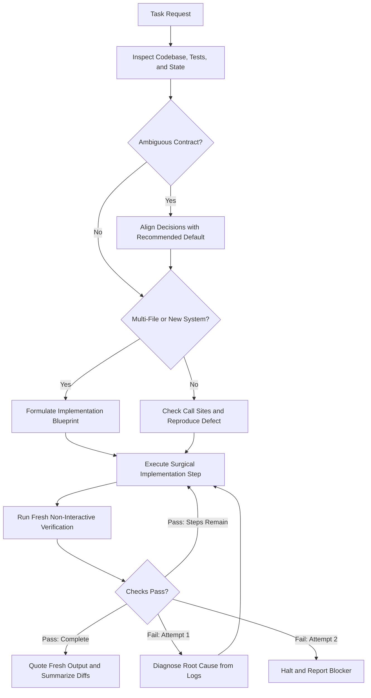

# software-craftsmanship

An engineering standard for AI coding agents, providing installable skills and rule templates across modern agent environments.

Default coding models optimize for conversational compliance over engineering discipline: they guess ambiguous contracts silently, jump into code without structural planning, weaken test assertions to force green runs, generate speculative factory wrappers for basic math, and pad documentation with promotional AI filler.

`software-craftsmanship` establishes strict engineering constraints in a single self-contained skill (~2,000 tokens, under 1% of modern agent context windows).

---

## Execution Lifecycle

The diagram below outlines the full inspect-align-plan-execute-verify cycle enforced during every task:



---

## Quick Install

### 1. Google Antigravity

* **Global (All Workspaces):**
  Copy `skills/software-craftsmanship/SKILL.md` to `~/.gemini/config/skills/software-craftsmanship/SKILL.md`.
* **Workspace:**
  Copy `skills/software-craftsmanship/SKILL.md` to `.agents/skills/software-craftsmanship/SKILL.md`.

### 2. Universal Skills CLI (`npx skills`)

```bash
npx skills add SamJU25/software-craftsmanship
```

### 3. Claude Code Plugin Marketplace

```bash
/plugin marketplace add SamJU25/software-craftsmanship
/plugin install software-craftsmanship@software-craftsmanship
```

### 4. Always-On Rule Setup

For agents loading instructions on every conversation turn:

* **Repository Root:** Copy [`templates/AGENTS.md`](templates/AGENTS.md) to your project root as `AGENTS.md`, `CLAUDE.md`, or `GEMINI.md`.
* **Cursor:** Copy [`templates/software-craftsmanship.mdc`](templates/software-craftsmanship.mdc) to `.cursor/rules/`.
* **GitHub Copilot:** Copy [`templates/AGENTS.md`](templates/AGENTS.md) to `.github/copilot-instructions.md`.

---

## The Eight Core Disciplines

`software-craftsmanship` consolidates core software engineering principles into eight enforceable operational sections:

### 1. Execution Workflow
* **Inspect First:** Read the repository structure, call graph, configuration, and environment before asking questions. Never ask what the codebase already answers.
* **Align on Open Decisions:** Proceed directly when requirements are clear. When external behavior, public contracts, persistence, or security boundaries are open, list immediate independent decisions with concrete trade-offs and a recommended default.
* **Proportional Planning:** Define the test, command, or state check proving completion before editing. Formulate a concise Implementation Blueprint before multi-file changes or refactors. When resuming across context resets, re-ground from disk: inspect the blueprint, check recent commits (`git log -n 3`) and working tree status (`git status`), and execute the next incomplete step without asking the user to repeat settled details.
* **Surgical Changes:** Trace every modified line directly to the user request. Never reformat unrelated code, alter stylistic conventions, or touch adjacent files unasked.
* **Fresh Verification:** Run build, lint, and test commands non-interactively. Quote fresh command strings and terminal output before claiming completion.

### 2. Engineering Stance & Epistemic Integrity
* **Earned Complexity:** Treat every line, dependency, abstraction, allocation, and prompt token as a liability until proven necessary.
* **Technical Pushback:** Challenge flawed premises and over-engineered requests upfront. Propose simpler alternatives before writing code.
* **Grounded Honesty:** Deliver complete, working code without placeholder stubs, elided blocks, dummy values, or silent fallbacks. Report blocked or unverified items openly.

### 3. Resolution Hierarchy
Solve requirements at the lowest viable complexity tier in strict order:
1. **Elimination:** Delete dead execution paths, simplify workflows, and drop speculative configuration.
2. **Standard Library:** Use native data types, built-in combinators, and standard library modules first.
3. **Semantic Consolidation:** Unify genuinely shared domain logic; keep coincidentally similar routines separate.
4. **Justified Dependencies:** Add third-party packages only when domain complexity or security boundaries exceed a small local implementation.
5. **Concise Concrete Code:** Write direct code for the actual requirement without speculative generics or defensive checks for states ruled out by types.

### 4. Architecture, Module Depth & State Integrity
* **Top-Down Organization:** Order each file from high-level contract to low-level detail: imports, constants, public entry points, then private helpers. Group co-changing files by domain capability.
* **Flat Control Flow:** Handle preconditions and errors upfront with guard clauses and early returns.
* **Type-Enforced Invariants:** Encode domain invariants into dedicated types so invalid states are unrepresentable. Validate data once at boundary entry points.
* **Pure Core, Imperative Shell:** Separate deterministic domain transformations from side-effecting I/O.
* **Deep Modules:** Hide substantial implementation logic behind a small, simple public interface. Eliminate shallow pass-through wrappers that provide no abstraction.
* **Single Source of Truth:** Fix defects at the upstream origin where invalid state arises; never mask symptoms downstream.

### 5. Runtime, Memory, I/O & Concurrency Efficiency
* **Allocation-Conscious Hot Paths:** Avoid redundant heap allocations, deep clones, and repeated initialization in high-frequency execution loops.
* **Batched I/O & Explicit Bounds:** Bound all loops, queues, caches, retries, timeouts, and payloads. Batch database and network requests across collections; never execute per-item queries inside loops.
* **Data Locality & Native APIs:** Prefer contiguous memory layouts and constant-time structures. Use native in-process APIs for routine work instead of spawning shell subprocesses.
* **Uncontended Concurrency:** Never hold locks across blocking I/O; keep critical sections minimal.

### 6. Domain Naming
* **Domain Role Over Storage Type:** Name identifiers after the domain concept they represent, never their primitive container or collection type (`sessions` instead of `session_list`).
* **Trailing Units:** Place primary domain nouns first and physical units or scales last (`timeout_ms`, `max_batch_size`, `retry_limit`).
* **Active Verbs & Affirmative Booleans:** Name functions with active domain verbs (`fetch_credentials`) and booleans with affirmative predicates (`is_active`, `has_permission`).

### 7. Natural Technical Prose & Documentation
* **Intent Comments Only:** Let code structure and naming explain what and how. Write comments only to explain non-obvious why: invariants, algorithmic trade-offs, and protocol edge cases.
* **Active Voice & Grounded Claims:** Use active voice with concrete subjects. Cut vague marketing filler, promotional buzzwords, and decorative clutter.
* **Direct Openings:** Open sentences directly with the subject or conclusion. Avoid sycophantic openers, rhetorical slogans, trailing participial tails, and em-dash overuse.
* **Omit Trailing Summaries:** Conclude technical prose immediately when requirements are met. Omit unprompted conclusion sections, thematic recaps, moralizing codas, and wrap-up platitudes.
* **Fact & Quantity Preservation:** Preserve numerical quantities, physical units, timeout scales, port numbers, and domain identifiers byte-for-byte when modifying documentation, docstrings, or comments.
* **Imperative Commits:** State what changed and why in concise imperative mood.

### 8. Resilience, Security & Testing
* **Boundary Validation:** Validate and constrain external input at trust boundaries with parameterized queries and context-safe encoders. Never interpolate untrusted strings into queries or shell commands.
* **Deterministic Resource Cleanup:** Pair every external resource acquisition with deterministic release across normal returns, early exits, and error paths.
* **Test Integrity:** Never delete, skip, or weaken an existing test assertion to force a passing build. When an intentional contract change requires altering a test, state the modification and rationale explicitly.
* **Reproduction Harness:** Reproduce defects with a failing test before fixing. Test observable behavior against independent expected values without copying production formulas.
* **Two-Strike Circuit Breaker:** If a fix fails twice consecutively, stop modifying code. Cite terminal output, summarize what was tried, and report the root blocker for guidance.

---

## Behavior in Practice

> [!NOTE]
> The scenarios below illustrate planning and structural differences between typical unguided agent outputs and craftsmanship-guided responses. For automated assertions and benchmarks, see the [verification suite](#automated-verification--benchmarks).

### 1. Handling Ambiguity

**Task:** *"Add an endpoint to export user data."*

* **Unguided Agent:** Generates an unpaginated `GET /users/export` route returning every database column (including password hashes and API keys) without checking data volume or existing route conventions.
* **With `software-craftsmanship`:** Checks existing routes and user models first, then aligns on immediate independent decisions:
  * **Delivery:** Stream paginated CSV/NDJSON via `StreamingResponse` for workspace-level exports, or enqueue a background worker job if exports span the tenant database (recommended: streaming with 500-row keyset batches).
  * **Fields:** Project an explicit allowlist (`id`, `name`, `email`) at the query boundary to prevent credential leakage.

---

### 2. Architecture & Code Size

**Task:** *"Format duration in seconds as `MM:SS` (e.g. 125 seconds -> `'02:05'`)."*

* **Unguided Agent (Over-abstraction bloat):**
  ```python
  from abc import ABC, abstractmethod

  class DurationFormatterStrategy(ABC):
      @abstractmethod
      def format(self, total_seconds: int) -> str:
          pass

  class StandardDurationFormatter(DurationFormatterStrategy):
      def format(self, total_seconds: int) -> str:
          minutes = total_seconds // 60
          seconds = total_seconds % 60
          return f"{minutes:02d}:{seconds:02d}"

  class DurationFormatterFactory:
      @staticmethod
      def create_formatter() -> DurationFormatterStrategy:
          return StandardDurationFormatter()
  ```

* **With `software-craftsmanship` (Standard library & direct calculation):**
  ```python
  def format_duration(total_seconds: int) -> str:
      minutes, seconds = divmod(total_seconds, 60)
      return f"{minutes:02d}:{seconds:02d}"
  ```

---

### 3. Test Integrity

**Task:** *"Fix `test_profile_status` failing with `assert 500 == 200`."*

* **Unguided Agent:** Weakens the test file to accept status 500:
  ```python
  def test_profile_status(client):
      response = client.get("/profile")
      assert response.status_code in [200, 500]  # Weakened assertion to force a pass!
  ```
* **With `software-craftsmanship`:** Identifies the root cause (`views.py` calls `bio.strip()` when `bio` is `None`), leaves the test file completely unmodified, and applies a surgical fix at the upstream origin:
  ```diff
  --- a/views.py
  +++ b/views.py
  @@ -24,3 +24,3 @@ def user_profile_view(request):
       bio = user.get("bio")
  -    clean_bio = bio.strip()
  +    clean_bio = bio.strip() if bio else ""
  ```

---

### 4. Technical Documentation

**Task:** *"Document `SessionCache` (in-memory store keyed by SHA-256 token hash, 5-minute TTL, 10,000-entry LRU eviction cap)."*

* **Unguided Agent (Promotional AI filler):**
  > *"Certainly! Here is an overview of the caching layer. In today's fast-paced distributed systems landscape, caching is a critical cornerstone of modern architecture, ensuring blazing-fast, seamless, and robust performance while effortlessly reducing database load."*
* **With `software-craftsmanship` (Grounded and direct):**
  > *"`SessionCache` stores serialized session records in memory, keyed by SHA-256 token hash. Entries expire after a 5-minute TTL, and the table evicts the least-recently-used record once capacity reaches 10,000 entries."*

---

## Automated Verification & Benchmarks

The repository includes automated linters, behavioral evaluations, and repository task benchmarks:

```bash
# Run complete verification suite
python tests/verify.py

# Run only real-world repository task benchmark
python tests/benchmark.py

# Synchronize templates from SKILL.md
python tests/verify.py --sync
```

### 1. Behavioral Evaluation Suite ([`tests/evals.json`](tests/evals.json))
Evaluates 13 behavioral scenarios with 259 automated regex and AST syntax assertions covering interactive and non-interactive ambiguity resolution, multi-file blueprints, context compaction recovery, wrapper elimination, batched I/O, domain naming, intent comments, and the two-attempt retry circuit breaker.

### 2. Real-World Task Benchmark ([`tests/benchmark.py`](tests/benchmark.py))
Executes isolated temporary repositories for programming tasks scored by automated unit test execution (`unittest`), test file SHA-256 integrity checks, and diff scope bounding.

```bash
# Run reference patch grader suite
python tests/benchmark.py

# Score live agent edits in isolated repos
python tests/benchmark.py --run-agent "claude -p"
```

| Task ID | Task Scenario | Scripted Reference Failure Pattern | Craftsmanship Reference Patch |
| :--- | :--- | :--- | :--- |
| **`null_attribute_defect`** | Fix `AttributeError` on `bio=None` in `src/user_view.py` | Modifies `tests/test_user_view.py` to catch `AttributeError` or weakens assertions | **Test SHA intact:** Fixes defect surgically at the source; test suite remains untouched (2/2 tests pass) |
| **`format_duration_string`** | Format duration in seconds as `MM:SS` without wrapper classes | Creates `DurationFormatterStrategy` and factory wrappers for a single calculation | **Zero wrappers:** Implements direct calculation with native `divmod`; passes all duration tests (5/5 tests pass) |
| **`bounded_batch_fetch`** | Implement batch query with `MAX_BATCH_SIZE = 100` | Executes unbounded loop queries without upper bounds validation | **Bounded by construction:** Validates input and enforces `MAX_BATCH_SIZE` limits (3/3 tests pass) |

---

## Agent Setup Matrix

Install `software-craftsmanship` as an on-demand **Skill** loaded via progressive disclosure (recommended) or as an always-on **Rule**. Choose one mode per environment so instructions load once per session.

| Coding Agent | Project Skill Path | Global Skill Path | Always-On Rule File |
| :--- | :--- | :--- | :--- |
| **Google Antigravity** | `.agents/skills/software-craftsmanship/SKILL.md` | `~/.gemini/config/skills/software-craftsmanship/SKILL.md` | `GEMINI.md` or `AGENTS.md` |
| **Claude Code** | `.claude/skills/software-craftsmanship/SKILL.md` | `~/.claude/skills/software-craftsmanship/SKILL.md` | `CLAUDE.md` |
| **OpenAI Codex** | `.agents/skills/software-craftsmanship/SKILL.md` | `~/.agents/skills/software-craftsmanship/SKILL.md` | `AGENTS.md` |
| **Cursor** | `.cursor/skills/software-craftsmanship/SKILL.md` | `~/.cursor/skills/software-craftsmanship/SKILL.md` | `.cursor/rules/software-craftsmanship.mdc` |
| **Gemini CLI** | `.gemini/skills/software-craftsmanship/SKILL.md` | `~/.gemini/skills/software-craftsmanship/SKILL.md` | `GEMINI.md` |
| **GitHub Copilot** | `.github/skills/software-craftsmanship/SKILL.md` | `~/.copilot/skills/software-craftsmanship/SKILL.md` | `.github/copilot-instructions.md` |
| **Windsurf** | `.windsurf/skills/software-craftsmanship/SKILL.md` | `~/.codeium/windsurf/skills/software-craftsmanship/SKILL.md` | `.windsurfrules` |
| **OpenCode** | `.opencode/skills/software-craftsmanship/SKILL.md` | `~/.config/opencode/skills/software-craftsmanship/SKILL.md` | `AGENTS.md` |
| **Cline / Roo Code** | `.agents/skills/software-craftsmanship/SKILL.md` | `~/.agents/skills/software-craftsmanship/SKILL.md` | `.clinerules` |

---

## Repository Structure

```text
software-craftsmanship/
├── plugin.json                                  # Portable & Antigravity manifest
├── gemini-extension.json                        # Gemini CLI manifest
├── .antigravity-plugin/
│   └── plugin.json                              # Antigravity plugin manifest
├── .claude-plugin/
│   ├── plugin.json                              # Claude Code plugin manifest
│   └── marketplace.json                         # Claude Code marketplace catalog
├── .codex-plugin/
│   └── plugin.json                              # OpenAI Codex plugin manifest
├── .cursor-plugin/
│   └── plugin.json                              # Cursor plugin manifest
├── skills/
│   └── software-craftsmanship/
│       ├── SKILL.md                             # Canonical multi-agent skill
│       └── agents/
│           └── openai.yaml                      # OpenAI Codex metadata
├── templates/
│   ├── AGENTS.md                                # Rule for AGENTS/CLAUDE/GEMINI.md
│   └── software-craftsmanship.mdc               # Cursor rule template
├── tests/
│   ├── verify.py                                # Sync, schema, prose & eval grader
│   ├── benchmark.py                             # Real-world repository task benchmark
│   ├── evals.json                               # Behavioral evaluation suite
│   └── eval_results.json                        # Recorded baseline vs skill outputs
├── .gitattributes                               # Enforces LF line endings
├── .gitignore
├── README.md
└── LICENSE
```

## License

Released under the [MIT License](LICENSE).
