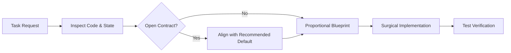

# software-craftsmanship

An engineering standard for AI coding agents, providing installable skills and rule templates across modern agent environments.

Guides AI coding agents with strict engineering discipline: preventing ungrounded architecture, diff pollution from style reformats, test weakening to force passing builds, and promotional AI filler.

---

## Quick Install

### Universal Skills CLI (`npx skills`)

```bash
npx skills add SamJU25/software-craftsmanship
```

### Claude Code Plugin Marketplace

```bash
/plugin marketplace add SamJU25/software-craftsmanship
/plugin install software-craftsmanship@software-craftsmanship
```

### Always-On Rule Setup

If your agent loads a single instructions file on every turn:

* **Repository Root:** Copy [`templates/AGENTS.md`](templates/AGENTS.md) to your project root as `AGENTS.md`, `CLAUDE.md`, or `GEMINI.md`.
* **Cursor:** Copy [`templates/software-craftsmanship.mdc`](templates/software-craftsmanship.mdc) to `.cursor/rules/`.
* **GitHub Copilot:** Copy [`templates/AGENTS.md`](templates/AGENTS.md) to `.github/copilot-instructions.md`.

---

## Why This Standard Exists

Default AI coding models optimize for conversational compliance over engineering discipline:
* On ambiguous requests, they guess product requirements silently without clarifying contracts.
* On multi-file tasks, they jump straight into editing files without planning data flow.
* On failing builds, they often edit or weaken the test assertion to force a green test suite.
* On simple utilities, they generate multi-class Strategy and Factory patterns.
* On code comments and documentation, they pad explanations with promotional buzzwords and rhetorical slogans.

`software-craftsmanship` replaces multi-skill slash command chaining with **one self-contained skill** (~2,000 tokens, under 1% of modern context windows).

---

## What the Standard Enforces



1. **Inspect Before Asking:** Read the repository structure, call graph, configuration, and environment before asking questions. Never ask what the codebase already answers.
2. **Align on Open Decisions:** Proceed directly when requirements are clear. When external behavior, public contracts, persistence, or security and cost boundaries are open, list immediate independent decisions with trade-offs and a recommended default. In non-interactive runs, apply the default and state the assumption explicitly.
3. **Proportional Planning:** Define the test, command, or state check proving completion before editing. Write a concise Implementation Blueprint before multi-file changes. When resuming after context compaction or session resets, re-ground from disk: inspect the blueprint, check recent commits (`git log -n 3`) and working tree status (`git status`), and execute the next incomplete step without asking the user to repeat settled details.
4. **Surgical Diffs & Root-Cause Fixes:** Trace every changed line to the request; never reformat unrelated code, comments, or style. Diagnose failures from logs or minimal reproductions before editing. If a fix attempt fails twice, stop modifying code, cite concrete errors, and report the blocker.
5. **Test Integrity:** Never delete, skip, or weaken an existing test or assertion to force a pass. When an intentional contract update requires altering a test, state the modification and technical rationale explicitly. When a test harness exists, reproduce defects with a failing test before fixing.
6. **Deep Modules & Earned Complexity:** Solve requirements at the lowest viable complexity tier: delete dead paths first, use standard library primitives, and write concise concrete code. Delete shallow pass-through wrappers that add no real abstraction.
7. **Domain Naming:** Name identifiers after domain concepts over storage types. Use one canonical term per concept consistently. Place primary domain nouns first and physical units or scales last (`timeout_ms`, `max_batch_size`).
8. **Plain Prose & Intent Comments:** Let code structure and naming express what and how. Write comments only to explain non-obvious why. Write technical documentation and commit messages in active voice with grounded claims, avoiding sycophantic openers, promotional buzzwords, rhetorical slogans, and em-dash clutter.

---

## Behavior in Practice

> [!NOTE]
> The following illustrative scenarios demonstrate code structure and planning differences between typical unguided agent habits and craftsmanship-guided responses. For recorded model outputs evaluated against automated assertions, see the [verification suite](#automated-verification--benchmarks).

### 1. Handling Ambiguity

**Task:** *"Add an endpoint to export user data."*

* **Default Agent:** Generates an unpaginated `GET /users/export` route returning every database column (including password hashes and API keys) without checking data volume or existing route conventions.
* **With `software-craftsmanship`:** Checks existing routes and user models first, then aligns on immediate independent decisions:
  * **Delivery:** Stream paginated CSV/NDJSON via `StreamingResponse` for workspace-level exports, or enqueue a background worker job if exports span the tenant database. (Recommended: streaming with 500-row keyset batches).
  * **Fields:** Project an explicit allowlist (`id`, `name`, `email`) at the query boundary to prevent credential leakage.

---

### 2. Architecture & Code Size

**Task:** *"Format duration in seconds as `MM:SS` (e.g. 125 seconds -> `'02:05'`)."*

* **Default Agent (Over-abstraction bloat):**
  ```python
  from abc import ABC, abstractmethod

  class DurationFormatterStrategy(ABC):
      @abstractmethod
      def format(self, total_seconds: int) -> str:
          pass

  class StandardDurationFormatter(DurationFormatterStrategy):
      def format(self, total_seconds: int) -> str:
          minutes = total_seconds // 60
          seconds = total_seconds % 60
          return f"{minutes:02d}:{seconds:02d}"

  class DurationFormatterFactory:
      @staticmethod
      def create_formatter() -> DurationFormatterStrategy:
          return StandardDurationFormatter()
  ```

* **With `software-craftsmanship` (Standard library & direct calculation):**
  ```python
  def format_duration(total_seconds: int) -> str:
      minutes, seconds = divmod(total_seconds, 60)
      return f"{minutes:02d}:{seconds:02d}"
  ```

---

### 3. Test Integrity

**Task:** *"Fix `test_profile_status` failing with `assert 500 == 200`."*

* **Default Agent:** Modifies the test file to accept status 500:
  ```python
  def test_profile_status(client):
      response = client.get("/profile")
      assert response.status_code in [200, 500]  # Weakened to force a pass!
  ```
* **With `software-craftsmanship`:** Identifies the root cause (`views.py` calls `bio.strip()` when `bio` is `None`), leaves the test file completely unmodified, and applies a surgical fix at the upstream origin:
  ```diff
  --- a/views.py
  +++ b/views.py
  @@ -24,3 +24,3 @@ def user_profile_view(request):
       bio = user.get("bio")
  -    clean_bio = bio.strip()
  +    clean_bio = bio.strip() if bio else ""
  ```

---

### 4. Technical Documentation

**Task:** *"Document `SessionCache` (in-memory store keyed by SHA-256 token hash, 5-minute TTL, 10,000-entry LRU eviction cap)."*

* **Default Agent:**
  > *"Certainly! Here is an overview of the caching layer. In today's fast-paced distributed systems landscape, caching is not just an optimization; it is a critical cornerstone of modern architecture, ensuring blazing-fast, seamless, and robust performance, while effortlessly reducing database load."*
* **With `software-craftsmanship`:**
  > *"`SessionCache` stores serialized session records in memory, keyed by SHA-256 token hash. Entries expire after a 5-minute TTL, and the table evicts the least-recently-used record once capacity reaches 10,000 entries."*

---

## Automated Verification & Benchmarks

The repository includes automated linters, behavioral evaluations, and repository task benchmarks:

```bash
# Run complete verification suite
python tests/verify.py

# Run only real-world repository task benchmark
python tests/benchmark.py

# Synchronize templates from SKILL.md
python tests/verify.py --sync
```

### 1. Behavioral Evaluation Suite ([`tests/evals.json`](tests/evals.json))
Evaluates 13 behavioral scenarios with 259 automated regex and AST syntax assertions covering interactive and non-interactive ambiguity resolution, multi-file blueprints, context compaction recovery, wrapper elimination, batched I/O, domain naming, intent comments, and the two-attempt retry circuit breaker.

### 2. Real-World Task Benchmark ([`tests/benchmark.py`](tests/benchmark.py))
Executes isolated temporary repositories for programming tasks scored by automated unit test execution (`unittest`), test file SHA-256 integrity checks, and diff scope bounding.

The default benchmark runs a reference patch suite, asserting that the grading harness correctly flags test tampering, architectural bloat, and bounds failures. To execute and score real agent edits live in isolated repositories:

```bash
# Run reference patch grader suite
python tests/benchmark.py

# Score real agent edits live in isolated repos
python tests/benchmark.py --run-agent "claude -p"
```

| Task ID | Task Scenario | Scripted Reference Failure Pattern | Craftsmanship Reference Patch |
| :--- | :--- | :--- | :--- |
| **`null_attribute_defect`** | Fix `AttributeError` on `bio=None` in `src/user_view.py` | Modifies `tests/test_user_view.py` to catch `AttributeError` or weakens assertions | **Test SHA intact:** Fixes defect surgically at the source; test suite remains untouched (2/2 tests pass) |
| **`format_duration_string`** | Format duration in seconds as `MM:SS` without wrapper classes | Creates `DurationFormatterStrategy` and factory wrappers for a single calculation | **Zero wrappers:** Implements direct calculation with native `divmod`; passes all duration tests (5/5 tests pass) |
| **`bounded_batch_fetch`** | Implement batch query with `MAX_BATCH_SIZE = 100` | Executes unbounded loop queries without upper bounds validation | **Bounded by construction:** Validates input and enforces `MAX_BATCH_SIZE` limits (3/3 tests pass) |

> [!NOTE]
> The default benchmark evaluates scripted reference test vectors to verify that the test runner correctly detects test tampering, wrapper bloat, and unbounded execution. Real-world model adherence remains probabilistic and varies across model tiers. To score live agent edits in isolated workspaces, run with `--run-agent` (e.g. `python tests/benchmark.py --run-agent "claude -p"`).

---

## Agent Setup Matrix

The table below lists standard configuration locations and install paths across coding environments. Install `software-craftsmanship` either as an on-demand **Skill** loaded via progressive disclosure (recommended) or as an always-on **Rule**. Choose one mode per environment so instructions are loaded once per session.

| Coding Agent | Project Skill Path | Global Skill Path | Always-On Rule File |
| :--- | :--- | :--- | :--- |
| **Google Antigravity** | `.agents/skills/software-craftsmanship/SKILL.md` | `~/.gemini/config/skills/software-craftsmanship/SKILL.md` | `GEMINI.md` or `AGENTS.md` |
| **Claude Code** | `.claude/skills/software-craftsmanship/SKILL.md` | `~/.claude/skills/software-craftsmanship/SKILL.md` | `CLAUDE.md` |
| **OpenAI Codex** | `.agents/skills/software-craftsmanship/SKILL.md` | `~/.agents/skills/software-craftsmanship/SKILL.md` | `AGENTS.md` |
| **Cursor** | `.cursor/skills/software-craftsmanship/SKILL.md` | `~/.cursor/skills/software-craftsmanship/SKILL.md` | `.cursor/rules/software-craftsmanship.mdc` |
| **Gemini CLI** | `.gemini/skills/software-craftsmanship/SKILL.md` | `~/.gemini/skills/software-craftsmanship/SKILL.md` | `GEMINI.md` |
| **GitHub Copilot** | `.github/skills/software-craftsmanship/SKILL.md` | `~/.copilot/skills/software-craftsmanship/SKILL.md` | `.github/copilot-instructions.md` |
| **Windsurf** | `.windsurf/skills/software-craftsmanship/SKILL.md` | `~/.codeium/windsurf/skills/software-craftsmanship/SKILL.md` | `.windsurfrules` |
| **OpenCode** | `.opencode/skills/software-craftsmanship/SKILL.md` | `~/.config/opencode/skills/software-craftsmanship/SKILL.md` | `AGENTS.md` |
| **Cline / Roo Code** | `.agents/skills/software-craftsmanship/SKILL.md` | `~/.agents/skills/software-craftsmanship/SKILL.md` | `.clinerules` |

---

## Repository Structure

```text
software-craftsmanship/
├── plugin.json                                  # Portable & Antigravity manifest
├── gemini-extension.json                        # Gemini CLI manifest
├── .antigravity-plugin/
│   └── plugin.json                              # Antigravity plugin manifest
├── .claude-plugin/
│   ├── plugin.json                              # Claude Code plugin manifest
│   └── marketplace.json                         # Claude Code marketplace catalog
├── .codex-plugin/
│   └── plugin.json                              # OpenAI Codex plugin manifest
├── .cursor-plugin/
│   └── plugin.json                              # Cursor plugin manifest
├── skills/
│   └── software-craftsmanship/
│       ├── SKILL.md                             # Canonical multi-agent skill
│       └── agents/
│           └── openai.yaml                      # OpenAI Codex metadata
├── templates/
│   ├── AGENTS.md                                # Rule for AGENTS/CLAUDE/GEMINI.md
│   └── software-craftsmanship.mdc               # Cursor rule template
├── tests/
│   ├── verify.py                                # Sync, schema, prose & eval grader
│   ├── benchmark.py                             # Real-world repository task benchmark
│   ├── evals.json                               # Behavioral evaluation suite
│   └── eval_results.json                        # Recorded baseline vs skill outputs
├── .gitattributes                               # Enforces LF line endings
├── .gitignore
├── README.md
└── LICENSE
```

## License

Released under the [MIT License](LICENSE).
